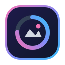

<div align="center">



# Wallpaper Studio for Antigravity

**为 Google Antigravity 打造的零侵入 Wallpaper Engine 贴背壁纸 + 极简上下文圆环 HUD 插件**

支持 Steam Wallpaper Engine 全类型壁纸（视频 / 3D 场景 / 网页 / 图片）· 双缓冲淡入淡出 · 50Hz 实时连续调参 · 随机轮播 · 毫秒级切换对话追踪

[](https://github.com/Cl-Ask47/antigravity-wallpaper-studio/releases)
[](./LICENSE)
[](#环境要求)

</div>

> **非官方社区项目免责声明**：本项目为独立开源插件，与 Google LLC 或 Wallpaper Engine 官方无任何隶属或背书关系。

---

## 核心特性

| 模块 | 能力说明 |
| :--- | :--- |
| **零侵入 Windows 贴背壁纸** | 严格遵循 Antigravity 官方 Sidecar 插件规范，**绝不修改 `app.asar`、`config.json` 或客户端快捷方式，不开启也不连接 CDP 调试端口**。使用独立 WPF + Microsoft Edge WebView2 伴侣窗口严格贴靠在 Antigravity 窗口正后方，完整保留原生输入框、Allow/Deny 审批弹窗、`/` 快捷命令与粘贴图片体验。 |
| **跑通 Wallpaper Engine 全类型壁纸** | 自动扫描本机 Steam `libraryfolders.vdf`、工坊目录（AppID `431960`）与默认项目：<br>• **Video（MP4/WebM/MKV）**：Chromium 硬解 + HTTP `206 Range` 流式循环播放；<br>• **3D Scene（`.pkg`）**：内置 **WebWallGL** WebGL2 实时渲染，并自动只读挂载本机 Wallpaper Engine 官方素材目录；<br>• **Web（HTML）**：内嵌沙箱 iframe 并注入 Wallpaper Engine 兼容 Shim；<br>• 任意场景异常时自动平滑回退高清预览图，不黑屏。 |
| **双缓冲平滑过渡 & 50Hz 实时调参** | A/B 双槽位双缓冲 `480ms` 交叉淡入淡出（消除切换黑屏闪烁）；调参侧栏通过 **SSE + 本机回环 UDP** 直通渲染舞台与 Win32 窗口，按住滑块持续拖动时（透显度 / 模糊 / 暗度 / 亮度 / 对比度 / 饱和度 / 圆环直径与配色）连续实时变化。 |
| **壁纸随机 / 顺序自动轮播** | 支持全部壁纸、仅视频、仅 3D 场景、仅网页、自定义勾选池（卡片右上角 `+`/`✓` 一键增删），以及自动同步 `dsh-wallpaper-engine` 的收藏列表；支持自定义间隔分钟数、实时倒计时与顶部「🎲 下一张」。 |
| **极简上下文圆环 HUD** | 悬浮于 Antigravity 窗口内（绝不遮挡其他软件窗口），直接只读官方 `transcript.jsonl` 中的精确 `input_tokens + cache_read_tokens + output_tokens` 与 Prompt Cache 命中率，支持 `256K / 512K / 1M` 上限；监听主窗标题 + `annotations/*.pbtxt`，切换历史对话 **~200ms 秒切**，空白新对话自动归零；支持左键拖动定位、双击归位与悬停详情。 |
| **随 Antigravity 自动启动 & 安全兜底** | `sidecar.json` 配置 `restart_policy: "always"` 并附带 `rules/AGENTS.md` 与 `/wallpaper-studio` 技能，打开 Antigravity 自动在后台拉起；最小化、锁屏、休眠、关闭开关、退出或异常时均自动将主窗恢复为 100% 不透明。 |

---

## 环境要求

- **操作系统**：Windows 10 / 11（64 位，内置 `.NET Framework 4.x` 与 Microsoft Edge WebView2 Runtime）
- **宿主客户端**：Google Antigravity App（支持 UI Sidecar 插件）
- **壁纸库**：本机已安装 Steam Wallpaper Engine（可选；未安装也可后续扩展自定义壁纸）
- **零外部 npm 依赖**：纯 Node.js 内置模块 + 系统自带 `csc.exe` 编译伴侣，开箱即用。

---

## 安装方式（三选一）

### 方式一：PowerShell 一行命令安装（推荐）

```powershell
irm https://raw.githubusercontent.com/Cl-Ask47/antigravity-wallpaper-studio/main/scripts/install.ps1 | iex
```

### 方式二：下载 Release 压缩包，双击即装

1. 前往 [Releases 页面](https://github.com/Cl-Ask47/antigravity-wallpaper-studio/releases/latest) 下载 `wallpaper-studio-v*.zip` 并解压。
2. 双击运行 **`install.cmd`**，脚本会将插件复制到 `~/.gemini/config/plugins/wallpaper-studio/`。
3. 打开 Antigravity（无需重启，插件自动热加载），在右侧面板 **Plugins → 壁纸与圆环** 打开控制面板，或在对话中输入 `/wallpaper-studio`。

### 方式三：使用 Antigravity CLI 或 Git 安装

```bash
# 通过 agy CLI 直接安装
agy plugin install https://github.com/Cl-Ask47/antigravity-wallpaper-studio

# 或手动克隆到插件目录
git clone https://github.com/Cl-Ask47/antigravity-wallpaper-studio.git "%USERPROFILE%\.gemini\config\plugins\wallpaper-studio"
```

---

## 卸载与恢复原貌

- **临时关闭**：点击控制面板顶部 **「恢复原貌」** 按钮，立即关闭贴背并恢复主窗 100% 不透明。
- **彻底卸载**：双击运行仓库内的 **`uninstall.cmd`**（或运行 `powershell -ExecutionPolicy Bypass -File scripts/uninstall.ps1`），会自动停止伴侣、恢复主窗不透明度并移除插件目录（个人配置保存在 `~/.gemini/antigravity/plugin_data/wallpaper-studio/`，传 `-PurgeData` 可一并清除）。

---

## 目录结构

```text
antigravity-wallpaper-studio/
├── plugin.json                         # Antigravity 插件清单
├── assets/logo.svg                     # 插件图标
├── rules/AGENTS.md                     # 常驻交互与自启规则
├── skills/wallpaper-studio/SKILL.md    # /wallpaper-studio 斜杠技能
├── install.cmd / uninstall.cmd         # Windows 一键安装 / 卸载入口
├── scripts/
│   ├── install.ps1                     # PowerShell 安装脚本（支持在线与本地）
│   └── uninstall.ps1                   # PowerShell 卸载与不透明度恢复脚本
└── sidecars/studio/
    ├── sidecar.json                    # UI Sidecar 定义（AUX_PANE + always 自启）
    ├── main.mjs                        # Sidecar 后端、轮播引擎与 /api/live 实时通道
    ├── media_server.mjs                # 本机回环流媒体、HTTP Range、SSE 与 WE 素材网关
    ├── stage.html                      # WebView2 双缓冲淡入淡出渲染舞台（Video/Scene/Web）
    ├── we_scanner.mjs                  # Steam libraryfolders.vdf 与工坊 431960 扫描器
    ├── context_tracker.mjs             # transcript.jsonl 精确 Token 与 pbtxt 标题追踪
    ├── companion_manager.mjs           # Windows 伴侣自动编译、单实例守护与 UDP 实时通道
    ├── index.html                      # 可折叠调参侧栏 + 壁纸库控制面板
    ├── companion/StudioCompanion.cs    # C# WPF + WebView2 贴背与极简圆环 HUD 源码
    └── vendor/                         # 内置 WebWallGL 与 Microsoft WebView2 运行时库
```

---

## 致谢与第三方许可

详见 [THIRD_PARTY_NOTICES.md](./THIRD_PARTY_NOTICES.md)：
- [WebWallGL](https://github.com/oneincase/webwallgl)（MIT License）提供浏览器端 Wallpaper Engine 3D Scene WebGL2 渲染核心；
- Microsoft Edge WebView2 SDK（`Microsoft.Web.WebView2`）提供原生 Windows 嵌入式 Chromium 视图；
- 架构思路参考了社区开源项目 `dsh-plugin-wallpaper-engine` 与 `agy-monitor` 的零侵入贴背实践。

本项目基于 [MIT License](./LICENSE) 开源。
